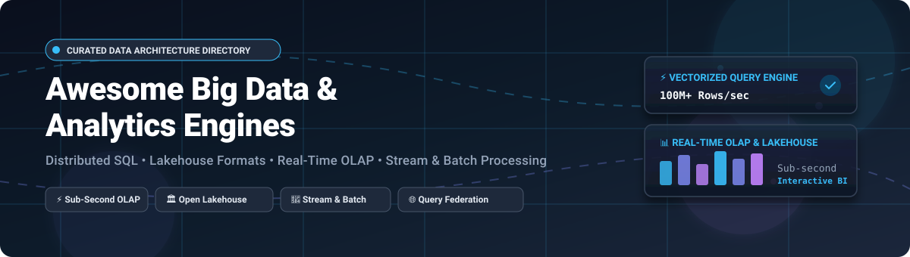

<p align="center">
  
</p>

# 🚀 Awesome Big Data & Analytics Engines

<p align="center">
  <a href="https://github.com/ishandutta2007/Awesome-Awesome-Awesome"></a>
  <a href="https://discord.gg/jc4xtF58Ve"></a>
  <a href="https://github.com/ishandutta2007/Awesome-Awesome-Awesome"></a>
  <a href="LICENSE"></a>
  <a href="https://github.com/ishandutta2007/Awesome-Big-Data-Analytics-Engines/pulls"></a>
  <a href="https://github.com/ishandutta2007"></a>
</p>

> 🌟 **A curated directory and market landscape** of leading enterprise SaaS platforms and open-source GitHub projects for big data processing, distributed SQL query engines, real-time OLAP databases, and open lakehouse architectures.

---

## 📑 Table of Contents

- [🔍 Overview & Architecture](#-overview--architecture)
- [📈 Sector Overview & Market Dynamics](#-sector-overview--market-dynamics)
- [☁️ SaaS & Managed Cloud Analytics Platforms](#-saas--managed-cloud-analytics-platforms)
- [⚡ Open-Source Analytics & Lakehouse Engines](#-open-source-analytics--lakehouse-engines)
- [🏛️ Architecture Comparison & Best Practices](#-architecture-comparison--best-practices)
- [⭐ Star History](#-star-history)
- [💖 Support & Community](#-support--community)
- [🤝 How to Contribute](#-how-to-contribute)
- [📜 Disclaimer](#-disclaimer)

---

## 🔍 Overview & Architecture

Modern data infrastructure centers around the **Lakehouse Architecture**, **decoupled compute and storage**, and **vectorized distributed query execution**. Whether managing petabyte-scale batch pipelines, sub-second interactive BI dashboards, or federated queries across hybrid clouds, selecting the right analytics engine is critical to balancing latency, scalability, operational overhead, and total cost of ownership (TCO).

This repository categorizes both enterprise-grade SaaS platforms and battle-tested open-source projects powering modern analytical engineering.

---

## 📈 Sector Overview & Market Dynamics

The global big data and analytics engine market is estimated at **$340+ billion in 2026** (with the core cloud data warehousing and lakehouse software sector exceeding **$45 billion** and growing at ~28% CAGR). The market is **moderately concentrated at the top infrastructure layer**—dominated by the hyperscalers (Google Cloud, Microsoft Azure, AWS) alongside independent category leaders (Snowflake, Databricks)—yet remains **highly fragmented and competitive across specialized workloads** such as real-time OLAP (ClickHouse, StarRocks, Doris), in-process analytics (DuckDB, DataFusion), and open lakehouse table management (Apache Iceberg, Delta Lake).

---

## ☁️ SaaS & Managed Cloud Analytics Platforms

The following SaaS and fully managed platforms represent category leaders in cloud data warehousing, lakehouses, real-time analytics, and federated query engines. The table is ranked by company scale (market capitalization or latest private valuation, descending).

| Platform | 🏢 Company Valuation / Scale | 💰 Starting Pricing | 🎁 Free Tier / Free Trial Limits | 🛠️ Key Capabilities |
| :--- | :--- | :--- | :--- | :--- |
| **[Microsoft Azure Synapse Analytics](https://azure.microsoft.com/en-us/products/synapse-analytics/)** | **~$3.1 Trillion** (Market Cap) | **$0.25 / vCore-hour** (Synapse Serverless SQL at $5.00 per TB processed; Dedicated pools start at $1.20/hour for DW100c) | **Azure Free Account: 12 months free access** to select services + **$200 credit for 30 days**; Synapse includes 5 TB/month free serverless SQL queries | Unified analytics service combining big data and enterprise data warehousing; native deep integration with Power BI, Azure Data Lake, and Microsoft Fabric. |
| **[Google BigQuery](https://cloud.google.com/bigquery)** | **~$2.1 Trillion** (Market Cap) | **$6.25 per TB** for on-demand queries; Editions start at **$0.04 per compute slot-hour** (Standard Edition) | **Free Forever Tier**: **10 GB storage per month** + **1 TB query processing per month** completely free; plus Google Cloud $300 credit 90-day trial | Fully managed, serverless multi-cloud data warehouse; built-in BigQuery ML, BI Engine sub-second caching, and native Apache Iceberg (BigLake) integration. |
| **[Amazon Redshift](https://aws.amazon.com/redshift/)** | **~$1.9 Trillion** (Market Cap) | **$0.25 per hour** (dc2.large provisioned node); Redshift Serverless starts at **$0.375 per RPU-hour** | **Free Trial**: **750 DC2.large hours per month for 2 months** under AWS Free Tier; Redshift Serverless offers **$300 credit for 90 days** | Cloud MPP data warehouse built for petabyte scale; Redshift Spectrum queries S3 data lakes directly without data loading; AQUA hardware-accelerated caching. |
| **[Snowflake](https://www.snowflake.com/)** | **~$52 Billion** (Market Cap; ~$3.4B ARR) | **$2.00 per credit** (Standard Edition compute credit; storage at $23/TB/month compressed) | **30-day Free Trial with $400 in platform credits** (no perpetual free tier) | Multi-cluster shared data architecture separating storage and compute; Snowpark for Python/Java, Snowpipe continuous streaming ingestion, native Zero-Copy Data Sharing. |
| **[Databricks](https://www.databricks.com/)** | **~$43 Billion** (Valuation; ~$2.6B ARR) | **$0.07 to $0.55 per DBU** (Databricks Unit, depending on workload tier: Jobs, Compute, or SQL Serverless) | **14-day Free Trial** with full platform capabilities across AWS, GCP, or Azure (cloud compute charges billed separately by provider) | Unified Data & AI Lakehouse platform founded by the creators of Apache Spark; Delta Lake storage format, high-performance C++ Photon execution engine, and Unity Catalog. |
| **[Teradata VantageCloud](https://www.teradata.com/)** | **~$3.2 Billion** (Market Cap; ~$1.8B ARR) | **~$1.90 per VantageCore unit/hour** (VantageCloud Lake pricing starts at blended ~$4,500/month deployment units) | **30-day Free Trial** with pre-configured VantageCloud Lake environment, loaded with sample datasets and $300 consumption credits | Enterprise-grade massively parallel processing (MPP) platform; ClearScape Analytics for advanced analytical operations and hybrid multi-cloud workload migration. |
| **[ClickHouse Cloud](https://clickhouse.com/)** | **~$2.0 Billion** (Valuation) | **$0.21 per compute unit/hour** + **$0.026 per GB/month** object storage | **30-day Free Trial with $300 usage credits** (no perpetual free tier) | Serverless, fully managed ClickHouse; column-oriented database delivering sub-second queries across billions of rows, vectorized execution, and real-time streaming ingestion. |
| **[SingleStore](https://www.singlestore.com/)** | **~$1.3 Billion** (Valuation) | **$0.80 per unit-hour** (SingleStore Helios Standard S-0.5 tier) | **Free Forever Tier**: Includes up to **$600/year compute credit** (Starter workspace allowance up to 4 S-0.25 units); plus $500 free trial credits for 30 days | Real-time distributed SQL database combining ACID transactional and fast analytical capabilities (HTAP); Universal Storage engine for transactional/analytical workloads. |
| **[Starburst Galaxy](https://www.starburst.io/)** | **~$1.2 Billion** (Valuation) | **$0.25 per Starburst Credit** (compute cluster running 1 coordinator + 2 workers starts at ~$0.75/hr) | **30-day Free Trial with $500 usage credits** (includes cross-cloud exploration capabilities) | Fully managed Trino platform for federated analytical queries across data lakes, warehouses, and operational databases without data migration or ETL pipeline duplication. |
| **[Firebolt](https://www.firebolt.io/)** | **~$1.4 Billion** (Valuation) | **$0.14 per Firebolt Compute Unit (FCU)/hour**; storage decoupled at S3 native rates (~$0.023/GB) | **30-day Free Trial with $200 usage credits** (no perpetual free tier) | Next-generation cloud data warehouse purpose-built for sub-second, user-facing analytics and high-concurrency low-latency analytical applications. |

---

## ⚡ Open-Source Analytics & Lakehouse Engines

Production-grade, community-backed open-source engines for batch processing, stream analytics, federated querying, OLAP databases, and table formats. Sorted in descending order by GitHub stargazers.

| Project & Repository | ⭐ Stars | 📂 Category & Architecture | 🚀 Key Features & Highlights |
| :--- | :--- | :--- | :--- |
| **[ClickHouse](https://github.com/ClickHouse/ClickHouse)** | [](https://github.com/ClickHouse/ClickHouse/stargazers) | Distributed Columnar OLAP Database | Sub-second queries on billions of rows; vectorized SIMD execution, real-time streaming data ingestion, rich SQL dialect, and disk data compression. |
| **[Apache Spark](https://github.com/apache/spark)** | [](https://github.com/apache/spark/stargazers) | Unified Distributed Compute Framework | De-facto standard for petabyte batch processing, Spark SQL, MLlib machine learning library, GraphX, Structured Streaming, and Spark Connect decoupled client. |
| **[DuckDB](https://github.com/duckdb/duckdb)** | [](https://github.com/duckdb/duckdb/stargazers) | In-Process Embedded OLAP Database | The "SQLite for Analytics"; zero-dependency embedded columnar engine with native vectorized execution, direct querying of Parquet/Arrow/CSV, and Python/R integrations. |
| **[Polars](https://github.com/pola-rs/polars)** | [](https://github.com/pola-rs/polars/stargazers) | Blazing-Fast DataFrame & Query Engine | Written in Rust on top of Apache Arrow; multithreaded query optimization, out-of-core streaming execution for larger-than-RAM workloads, and expressive API. |
| **[Apache Flink](https://github.com/apache/flink)** | [](https://github.com/apache/flink/stargazers) | Stateful Distributed Stream Processing | Low-latency event-driven stream analytics, exactly-once processing guarantees, Flink SQL, advanced state management, and unified bounded/unbounded computation. |
| **[TimescaleDB](https://github.com/timescale/timescaledb)** | [](https://github.com/timescale/timescaledb/stargazers) | Time-Series & Analytical PostgreSQL | PostgreSQL extension optimized for time-series and real-time analytics; automatic hypertable partitioning, continuous columnar aggregates, and native compression. |
| **[Apache Arrow](https://github.com/apache/arrow)** | [](https://github.com/apache/arrow/stargazers) | In-Memory Columnar Data Standard | Standardized language-independent columnar memory format for flat and hierarchical data; zero-copy data exchange, Flight RPC, and SIMD hardware acceleration. |
| **[Presto](https://github.com/prestodb/presto)** | [](https://github.com/prestodb/presto/stargazers) | Distributed SQL Query Engine | High-performance MPP SQL engine originally developed at Facebook; native SQL-on-Anything connector architecture for petabyte interactive querying. |
| **[Apache Doris](https://github.com/apache/doris)** | [](https://github.com/apache/doris/stargazers) | Real-Time MPP Analytical Database | MySQL protocol-compatible MPP database; supports ultra-fast concurrent point queries, aggregated reporting, inverted index text search, and lakehouse federation. |
| **[Apache Druid](https://github.com/apache/druid)** | [](https://github.com/apache/druid/stargazers) | Real-Time Operational Analytics Database | Tailored for real-time streaming ingestion from Kafka/Kinesis; sub-second OLAP slicing and dicing, time-indexed columnar storage, and high availability. |
| **[Trino](https://github.com/trinodb/trino)** | [](https://github.com/trinodb/trino/stargazers) | Federated Distributed SQL Engine | Massively parallel query engine for federated interactive SQL analytics across data lakes (S3, GCS, HDFS), RDBMS, NoSQL, and lakehouse formats without moving data. |
| **[StarRocks](https://github.com/StarRocks/starrocks)** | [](https://github.com/StarRocks/starrocks/stargazers) | Next-Gen Real-Time Vectorized OLAP | High-speed MPP analytics database with full vectorized SIMD pipeline, cost-based optimizer (CBO), real-time materialized views, and direct query federation on Apache Iceberg. |
| **[Apache DataFusion](https://github.com/apache/datafusion)** | [](https://github.com/apache/datafusion/stargazers) | Extensible In-Memory SQL Engine in Rust | Modular, embeddable distributed SQL query engine using Apache Arrow format; powers next-generation databases, query federators, and customized compute runtimes. |
| **[RisingWave](https://github.com/risingwavelabs/risingwave)** | [](https://github.com/risingwavelabs/risingwave/stargazers) | Distributed Streaming SQL Database | Stream processing database that treats streams as dynamic tables; incremental materialized views, PostgreSQL wire-compatibility, and sub-second streaming analytics. |
| **[Apache Iceberg](https://github.com/apache/iceberg)** | [](https://github.com/apache/iceberg/stargazers) | Open Lakehouse Table Format | Open table format for huge analytic datasets; supports ACID transactions, full schema evolution, partition evolution, snapshot isolation, and multi-engine interoperability. |
| **[Delta Lake](https://github.com/delta-io/delta)** | [](https://github.com/delta-io/delta/stargazers) | Open Lakehouse Storage Layer | Open-source lakehouse table format featuring ACID transactions, scalable metadata handling via transaction log, unified streaming/batch processing, and time travel. |
| **[Apache Beam](https://github.com/apache/beam)** | [](https://github.com/apache/beam/stargazers) | Unified Batch & Streaming Pipeline SDK | Multi-language programming model (Java, Python, Go) for defining data processing pipelines executed across runners like Apache Flink, Spark, and Google Cloud Dataflow. |
| **[Apache Hudi](https://github.com/apache/hudi)** | [](https://github.com/apache/hudi/stargazers) | Streaming Data Lakehouse Platform | Incremental data lake platform providing record-level upserts, deletes, change data capture (CDC), index-assisted queries, and file layout clustering. |
| **[Apache Pinot](https://github.com/apache/pinot)** | [](https://github.com/apache/pinot/stargazers) | Real-Time Distributed OLAP Datastore | Engineered at LinkedIn for user-facing, ultra-low latency analytical queries; real-time indexing from Kafka, pluggable indexing structures (star-tree), and horizontal scale. |
| **[Apache Hive](https://github.com/apache/hive)** | [](https://github.com/apache/hive/stargazers) | Distributed Data Warehouse Software | The pioneering SQL-on-Hadoop system; provides Hive Metastore (HMS) metadata standards, partition management, and batch processing integration for big data ecosystems. |
| **[Apache Calcite](https://github.com/apache/calcite)** | [](https://github.com/apache/calcite/stargazers) | Dynamic Data Management & SQL Parser | Highly extensible SQL parser, cost-based optimizer (CBO), and relational algebra framework that underpins engines such as Flink, Drill, Hive, and BlazingSQL. |
| **[Apache Kylin](https://github.com/apache/kylin)** | [](https://github.com/apache/kylin/stargazers) | Extreme OLAP Analytical Engine | Distributed analytics engine providing SQL interface and multi-dimensional analytics (MOLAP cube pre-computation) for sub-second queries on multi-petabyte datasets. |
| **[ByConity](https://github.com/byconity/byconity)** | [](https://github.com/byconity/byconity/stargazers) | Cloud-Native ClickHouse Fork | Open-source cloud-native analytical data warehouse based on ClickHouse; decoupled storage and compute, multi-tenant resource isolation, and elastic horizontal scalability. |
| **[Apache Kudu](https://github.com/apache/kudu)** | [](https://github.com/apache/kudu/stargazers) | Fast Columnar Storage on Rapid Data | Columnar storage manager developed for the Hadoop ecosystem that completes the gap between high-throughput sequential reads and low-latency random updates. |

---

## 🏛️ Architecture Comparison & Best Practices

```
+-----------------------------------------------------------------------------------+
|                           CONSUMPTION / APPLICATION LAYER                         |
|             (Superset, Metabase, Power BI, Tableau, Notebooks, LLM Agents)        |
+-----------------------------------------------------------------------------------+
                                          ▲
                                          │
+-----------------------------------------------------------------------------------+
|                        QUERY & EXECUTION ENGINE LAYER                             |
|  Interactive OLAP      Federated SQL       Batch & Streaming      Local / Embedded|
|  (ClickHouse, Doris,   (Trino, Presto,     (Apache Spark,         (DuckDB,        |
|   StarRocks, Pinot)     Starburst)          Apache Flink)          Polars, Arrow) |
+-----------------------------------------------------------------------------------+
                                          ▲
                                          │
+-----------------------------------------------------------------------------------+
|                         OPEN LAKEHOUSE TABLE LAYER                                |
|             (Apache Iceberg, Delta Lake, Apache Hudi, Hive Metastore)             |
+-----------------------------------------------------------------------------------+
                                          ▲
                                          │
+-----------------------------------------------------------------------------------+
|                         STORAGE & PERSISTENCE LAYER                               |
|               (Amazon S3, Google Cloud Storage, Azure ADLS Gen2, MinIO, HDFS)     |
+-----------------------------------------------------------------------------------+
```

### 🎯 Choosing the Right Engine

1. **⚡ For Real-Time Dashboards & Log Analytics**: Use **ClickHouse**, **StarRocks**, or **Apache Doris**. These engines deliver single-digit millisecond query response times over billions of records with column-oriented vectorized execution.
2. **🐘 For High-Scale Batch ETL & Machine Learning**: Use **Apache Spark** or **Databricks**. Their resilient distributed datasets (RDDs), Spark SQL, and Photon execution engine handle complex petabyte-scale data pipelines.
3. **🌊 For Low-Latency Streaming Analytics**: Use **Apache Flink** or **RisingWave** for stateful, exactly-once computations across sliding time windows and real-time Kafka pipelines.
4. **🌐 For Data Lake Query Federation (No-ETL)**: Use **Trino** or **Starburst Galaxy** to execute single SQL queries joining disparate sources across object storage, PostgreSQL, MongoDB, and Snowflake.
5. **🦆 For Local Analysis & In-Memory Data Science**: Choose **DuckDB** or **Polars**. They eliminate JVM overhead and database cluster provisioning, executing fast analytical SQL directly on local Parquet files.
6. **🧊 For Cloud-Native Lakehouse Storage**: Adopt **Apache Iceberg** or **Delta Lake** to future-proof storage, prevent vendor lock-in, and gain ACID transactions with snapshot isolation and time travel.

---

## ⭐ Star History

[](https://star-history.dera.page/#ishandutta2007/Awesome-Big-Data-Analytics-Engines&type=date&legend=top-left)

---

## 💖 Support & Community

Thank you for visiting and using this curated resource! If you find this repository helpful:

- ⭐ **Star this repository** to support discovery on GitHub and stay updated.
- 🍴 **Fork the repo** to keep a reference copy or contribute new engines.
- 📢 **Share it** with colleagues, data engineering communities, and on social channels.
- ☕ **Buy me a coffee / Sponsor**: If you'd like to support ongoing maintenance and new open-source initiatives, consider sponsoring via the **[GitHub Sponsors Dashboard](https://github.com/sponsors/ishandutta2007)**.

[](https://github.com/sponsors/ishandutta2007)

---

## 🤝 How to Contribute

Contributions are welcome! To add or update an analytics engine:

1. 🍴 Fork the repository.
2. 🌿 Create a new branch: `git checkout -b feature/add-engine-name`.
3. 📝 Add or edit entries in [README.md](file:///C:/Users/ishan/Documents/Projects/Awesome-Big-Data-Analytics-Engines/README.md).
   - For **SaaS platforms**, include exact valuation/revenue, starting pricing tier, and specific free tier/trial limits.
   - For **Open-source projects**, include the official repository link, star badge (`style=social&color=white`) linking to its stargazers page, architecture category, and factual capabilities.
4. 🚀 Open a Pull Request with a clear description of your additions.

---

## 📜 Disclaimer

- 📖 This is a community-curated directory intended for research, architectural planning, and educational purposes.
- 🏢 All product names, logos, and brands are property of their respective owners. Company valuations and pricing figures are based on publicly available filings and published pricing tiers as of 2026.
- 🔒 Ensure appropriate data governance, encryption, and regulatory compliance (GDPR, HIPAA, CCPA) when configuring distributed analytical workloads.

---

<div align="center">

**[⬆️ Back to Top](#-awesome-big-data-analytics-engines)**

</div>
